# BuildMate Rentals: Microsoft Fabric Medallion Pipeline and Power BI Dashboard

An end-to-end batch data pipeline on **Microsoft Fabric**. It takes four messy raw source systems of a heavy-equipment rental firm, moves them through a **Bronze → Silver → Gold** medallion in one Lakehouse, builds a conformed star schema, and serves a one-page **Direct Lake** Power BI dashboard for operations and finance.

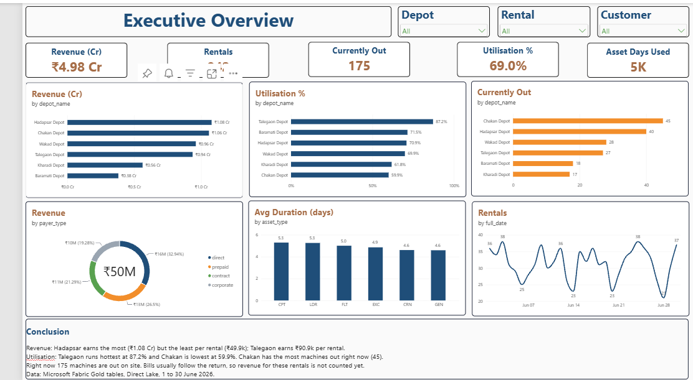

## Business problem

BuildMate Rentals hires out excavators, cranes, loaders, compactors, generators and forklifts from six depots around Pune. Four systems that do not talk to each other hold the data, so two questions had no trusted answer:

- **Operations** could not see which depots run hot or how many machines are out on site right now.
- **Finance** could not get revenue by depot, because the invoicing system has never heard of a depot and the rental system has never heard of money.

This project builds the pipeline and dashboard that answer both from one copy of the data.

## Architecture

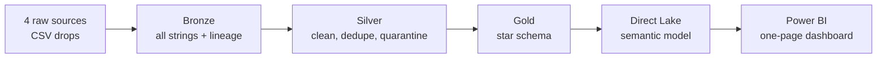

| Layer | What it holds | Notebook |
| --- | --- | --- |
| Bronze | Every source exactly as it arrived, all columns as strings, plus `ingested_at` and `source_file` | `nb_01_bronze` |
| Silver | Deduplicated, standardised, typed tables, a quarantine table and an unmatched-bills table | `nb_02_silver` |
| Gold | Three dimensions and two facts in a star schema | `nb_03_gold` |
| Queries | The six business questions in Spark SQL | `nb_04_queries` |

## Data

The raw archive holds one customer master export, 31 daily rental files (30 days plus one re-sent day), one billing export and one depot lookup, covering 1 to 30 June 2026. The data comes from a course exercise and is not included in this repository.

| Source | Raw rows | Problems found |
| --- | --- | --- |
| Customers | 602 | 2 duplicate registrations, 7 spellings of customer type, 2 date formats in one column |
| Rentals | 976 | 10 June sent twice, 5 spellings of rental type, 175 blank check-ins, 3 impossible check-ins |
| Billing | 787 | Amounts stored as text (`Rs. 64,157.16`), 10 spellings of payer type, 8 bills for rentals that do not exist |
| Depots | 6 | Clean |

## Results by layer

| Layer | Table | Rows |
| --- | --- | --- |
| Bronze | `bronze_customers` / `bronze_depots` / `bronze_rentals` / `bronze_billing` | 602 / 6 / 976 / 787 |
| Silver | `silver_customers` | 600 |
| Silver | `silver_rentals` / `silver_rentals_quarantine` | 942 / 3 |
| Silver | `silver_billing` / `silver_billing_unmatched` | 779 / 8 |
| Gold | `gold_dim_customer` / `gold_dim_depot` / `gold_dim_date` | 600 / 6 / 30 |
| Gold | `gold_fact_rental` / `gold_fact_billing` | 942 / 779 |

## The key engineering idea: null safety

A check-in earlier than the check-out is impossible, so those rows are quarantined. But a **blank check-in means the machine is still out**, not that the row is broken. In Spark, `NULL < timestamp` is `NULL`, not false, so the obvious filter silently deletes every machine still on site.

```python
bad = F.col("checkin_ts") < F.col("checkout_ts")

rent_ok  = rent.filter(~F.coalesce(bad, F.lit(False)))   # keeps the 175 still-out rentals
rent_bad = rent.filter(F.coalesce(bad, F.lit(False)))    # the 3 impossible rows
careless = rent.filter(~bad)                             # would drop all 175 still-out rentals
```

| Mistake avoided | Impact if made |
| --- | --- |
| `filter(~bad)` instead of `filter(~coalesce(bad, False))` | 175 live rentals silently deleted, so "machines currently out" would read zero |
| Parsing `REGISTERED_ON` with a single date format | 273 of 600 registration dates silently nulled |
| Cleaning amounts with `[^0-9.]` (the dot in `Rs.` survives) | 474 of 787 bill amounts nulled |
| Inner join of billing to rentals | The 8 orphan bills vanish instead of landing in a side table |

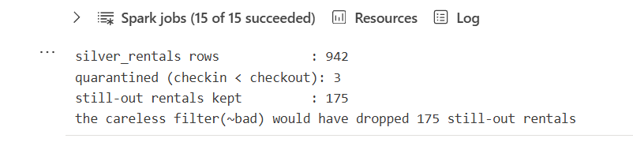

## Gold star schema

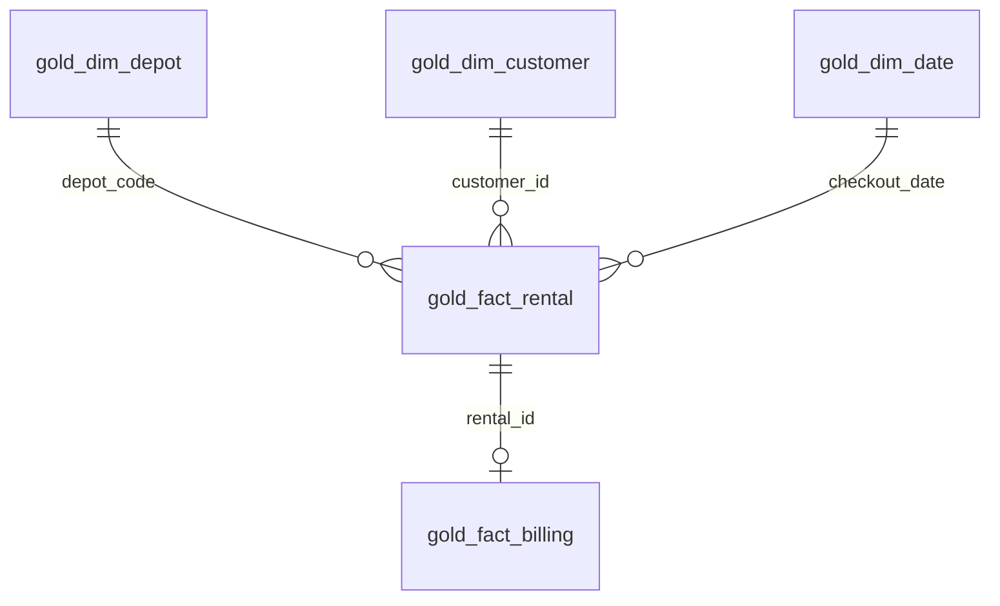

Derived in Gold, because no source system sends them:

- `tenure_years` and `tenure_band` on the customer dimension
- a 30-day calendar for the reporting window
- `rental_duration_days`, `is_returned` and `asset_days_in_window` on the rental fact

## Business answers

Figures below are from a run on the June 2026 data. Durations are whole days.

**Revenue by depot (query d)**

| Depot | Bills | Revenue (₹) | Revenue per rental (₹) | Currently out |
| --- | --- | --- | --- | --- |
| Hadapsar | 216 | 10,785,755 | 49,934 | 40 |
| Chakan | 152 | 10,587,483 | 69,654 | 45 |
| Wakad | 143 | 9,605,530 | 67,172 | 28 |
| Talegaon | 103 | 9,364,785 | 90,920 | 27 |
| Kharadi | 96 | 5,621,595 | 58,558 | 17 |
| Baramati | 69 | 3,810,253 | 55,221 | 18 |
| **Total** | **779** | **49,775,401** | | **175** |

**Fleet utilisation by depot (query b)**

| Depot | Fleet size | Asset days used | Utilisation |
| --- | --- | --- | --- |
| Talegaon | 25 | 654 | 87.2% |
| Baramati | 20 | 429 | 71.5% |
| Hadapsar | 55 | 1,170 | 70.9% |
| Wakad | 42 | 881 | 69.9% |
| Kharadi | 30 | 556 | 61.8% |
| Chakan | 48 | 863 | 59.9% |

**Revenue by payer type (query c):** direct ₹1.64 crore, prepaid ₹1.32 crore, contract ₹1.06 crore, corporate ₹0.96 crore.

**Rental mix (query e):** 72.3% standard (681 rentals), 27.7% priority (261 rentals).

**Average duration of returned rentals (query a):** compactors (5.29 days) and loaders (5.26) tie machines up longest; generators (4.59) and cranes (4.61) shortest.

The written interpretation for operations and finance is in [`stakeholder_writeup.md`](stakeholder_writeup.md).

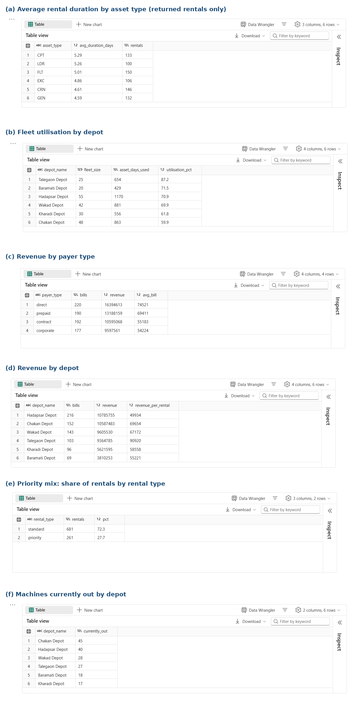
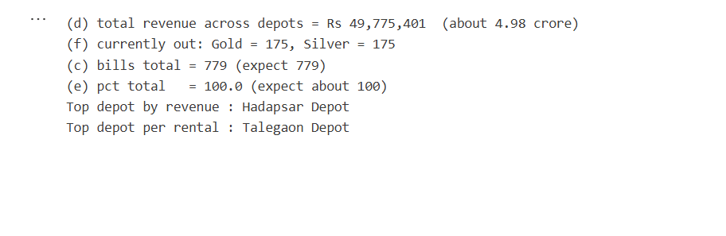

## Power BI dashboard

One 16:9 page built on a semantic model that reads the Gold Delta tables in OneLake through **Direct Lake**, so there is no import and no refresh job to keep in sync.

- **Filters:** depot, rental type, customer type
- **Headline cards:** revenue (₹ crore), rentals, machines currently out, fleet utilisation, asset days used
- **Depot comparison:** revenue, utilisation and machines currently out by depot
- **Drivers:** revenue by payer type, average days by asset type, rentals started per day
- **Conclusion box:** the page explains itself in a few lines

Orange is reserved for machines currently out, so the eye goes there first. The report theme is in [`dashboard/buildmate_theme.json`](dashboard/buildmate_theme.json).

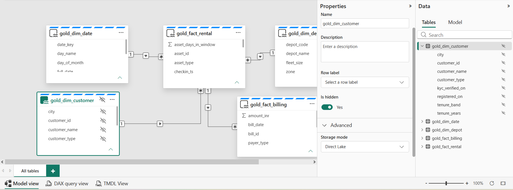

### Shared-capacity note

Fabric bills on one shared capacity, so every notebook, pipeline and Power BI query in the workspace draws from the same pool of compute. A heavy Spark job, such as a large `OPTIMIZE` or an unbounded join, can slow reports and other users' work until it finishes. I would watch the Microsoft Fabric Capacity Metrics app for CU usage and throttling, stop idle Spark sessions when I finish, schedule heavy jobs outside reporting hours, and keep Direct Lake models on the Gold tables only.

## Design decisions

- **Bronze is a photograph.** Everything is read as a string, with `inferSchema` off, so nothing is lost before it can be counted.
- **Latest row wins.** Customers and rentals are deduplicated with `row_number()` ordered by `ingested_at`, then `source_file`, then row id, because every row in one load shares the same timestamp.
- **Duration is NULL, not 0, while a machine is out.** Zero would claim it came back instantly and pull every average down.
- **The window is clipped.** `asset_days_in_window` counts only days inside 1 to 30 June, using `least()` and `greatest()`, and never exceeds 30.
- **No partitioning.** The tables hold under 1,000 rows. Partitioning only pays off at hundreds of millions of rows.
- **Delta tuning.** `OPTIMIZE ... ZORDER BY` on both fact tables, checked with `DESCRIBE HISTORY`.
- **Orphan bills are kept visible.** A left join routes the 8 unmatched bills to `silver_billing_unmatched` instead of dropping them.

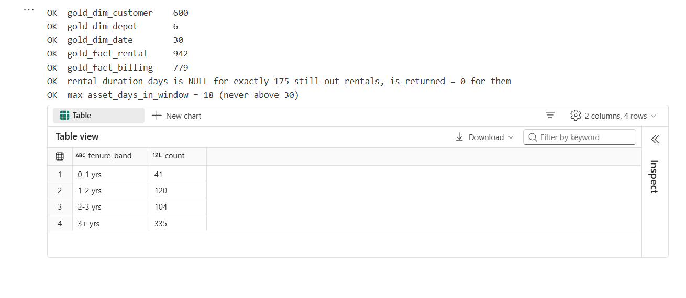
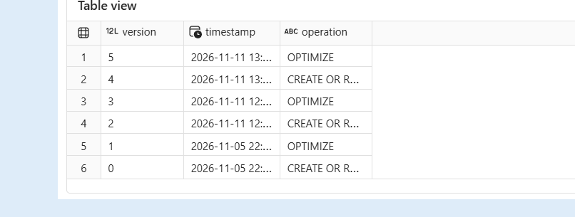

## How to reproduce

1. In [Microsoft Fabric](https://app.fabric.microsoft.com), create a workspace `ws_buildmate` and a Lakehouse `lh_buildmate`.
2. Upload the raw data archive to `Files/` and expand it in a notebook.
3. Import the notebooks from [`notebooks/`](notebooks), attach `lh_buildmate`, set `BASE` to your Files folder, and run them in order: `nb_01_bronze`, `nb_02_silver`, `nb_03_gold`, `nb_04_queries`.
4. Create a semantic model on the five `gold_` tables and add relationships from the facts to the dimensions, including `gold_fact_billing[rental_id]` to `gold_fact_rental[rental_id]`.
5. Add the measures, import the theme, and build the report page.

## Repository structure

```text
buildmate-fabric-medallion-pipeline/
├── README.md
├── stakeholder_writeup.md
├── LICENSE
├── notebooks/        one notebook per layer, plus the business queries
├── dashboard/        report theme
└── screenshots/      evidence for every task
```

## Tech stack

Microsoft Fabric (Lakehouse, Spark notebooks, OneLake), PySpark, Spark SQL, Delta Lake, Power BI (Direct Lake, DAX).

## Evidence

| Step | Screenshot |
| --- | --- |
| Bronze row counts | 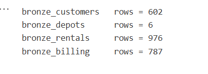 |
| Re-sent day proof (10 June, two files) | 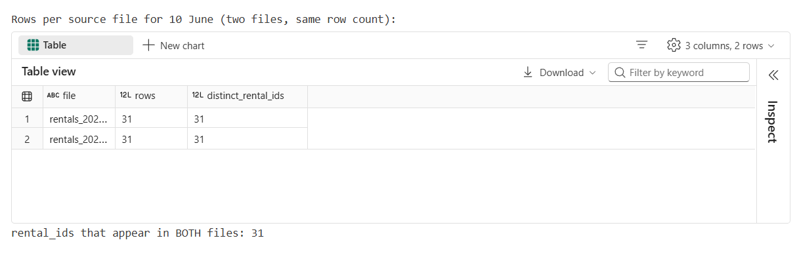 |
| Bronze checks | 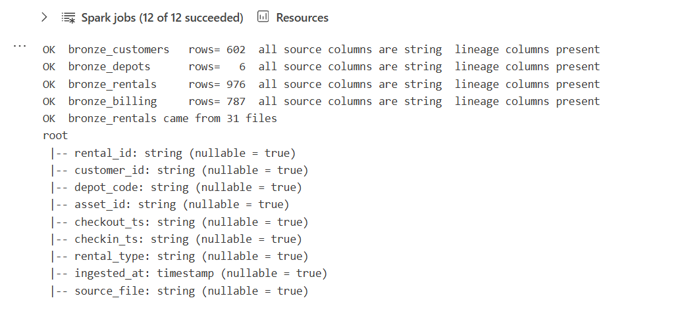 |
| Silver damage report | 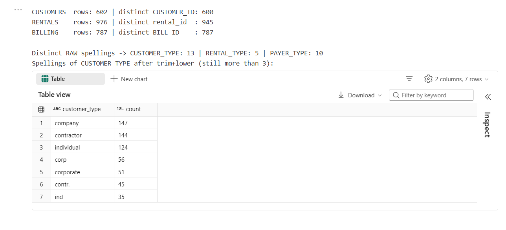 |
| Silver checks | 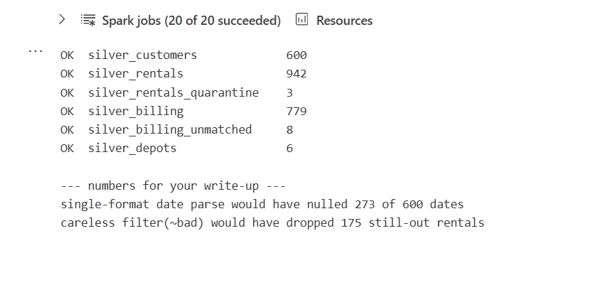 |
| Gold row counts | 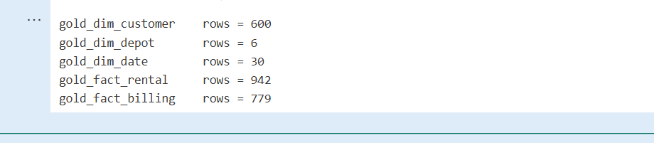 |

## Author

**Shubhangi**, Data Analyst and Power BI Developer, Pune, India. Core stack: Tableau, Power BI, SQL and Excel.

[GitHub](https://github.com/Shubh1015) · [LinkedIn](https://www.linkedin.com/in/shubhangi-jain0110/)

## License

MIT. See [`LICENSE`](LICENSE).
